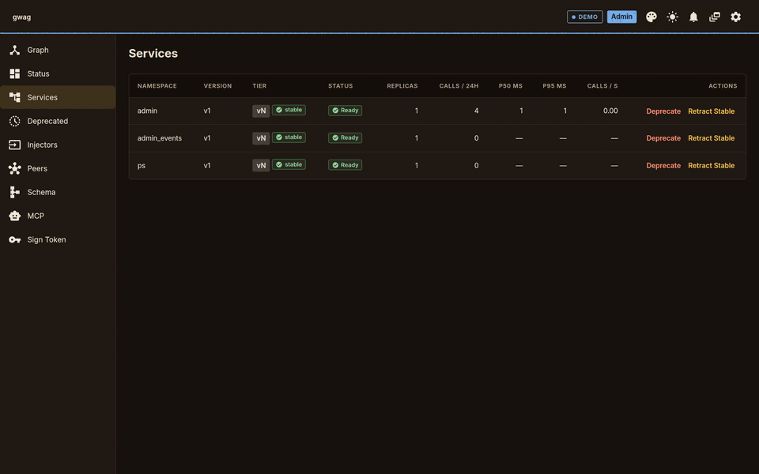

# gwag

[](./LICENSE)

A schema gateway for services. A service registers with a `.proto`, an
OpenAPI spec or a GraphQL endpoint. Every client gets the same
services as GraphQL, gRPC and REST/OpenAPI, with typed exports for its
own codegen tools. Because the gateway reads the schemas, it also
knows each service's versions, who calls which version, and which
changes break a caller.



## Why

Services and their callers rarely want the same thing:

- **Formats differ.** The service team writes gRPC; the browser team
  wants GraphQL; a partner wants REST with an OpenAPI file. Each pair
  ends up with a hand-written translation layer.
- **Nobody knows who calls what.** So old endpoints are never removed,
  and nobody can say whether a change is safe.
- **Breaking changes ship by accident.** A renamed field reaches
  production before the client that used it is rebuilt.

gwag sits between them and works from the schemas:

- **One registration, three surfaces.** GraphQL, gRPC (Connect,
  gRPC-Web) and HTTP/JSON for every registered service, plus schema
  exports (SDL, FileDescriptorSet, OpenAPI) for graphql-codegen,
  protoc, openapi-typescript and the rest.
- **Versions as data.** `unstable`, `stable` and numbered `vN` per
  service; an older `vN` is marked `@deprecated` as soon as a newer one
  registers, and that mark reaches generated clients.
- **Callers are counted.** Usage per caller and version, a dependency
  graph, declared external consumers. A version that something still
  depends on cannot be retired.
- **CI knows what breaks.** `gwag schema diff --strict` and frozen
  snapshots fail the build on a breaking change.

Two ways to run it:

- **`gat`**: a library inside one Go binary. Your
  [huma](https://huma.rocks/) handlers serve REST as before; gat adds
  GraphQL and gRPC from the same handlers. No second process.
- **`gwag`**: a gateway process (or 3+ node cluster on embedded NATS)
  in front of many services, which register at runtime over a gRPC
  control plane. Admin UI, auth, metrics, pub/sub.

## Quickstart

With Docker, from a checkout (the first run builds the image):

```bash
bin/gwag deploy up --platform docker-compose         # add --replicas 3 for a cluster
bin/gwag deploy login --platform docker-compose      # saves the admin token to .gw/
curl -s -X POST -H 'content-type: application/json' localhost:8080/api/graphql \
  -d '{"query":"{ __schema { queryType { name } } }"}'
```

`bin/gwag services list` and `bin/gwag peer list` now work. Without Docker,
`bin/gwag up` runs one node as a process. Kubernetes, minikube and ECS
files, replica rules and what is untested: [`docs/deploy.md`](./docs/deploy.md).

A gateway with two services and three client surfaces:

```bash
cd examples/multi && ./run.sh        # gateway + greeter + library (both proto)
curl -s -X POST localhost:8080/api/graphql \
  -d '{"query":"{ greeter { hello(name:\"world\") { greeting } } }"}'
# → {"data":{"greeter":{"hello":{"greeting":"Hello, world!"}}}}
```

## Where this ends up

Every service registered with gwag. Then the environment is known:

- **What runs:** every service, version and instance, in every
  environment.
- **Who calls what:** usage per caller and version, the dependency
  graph, consumers outside the gateway declared with a review date.
- **What each service needs:** its `Depends` and event `Subscribes`,
  checked before it starts.
- **What a change breaks:** known in CI, before it ships.

With that, teams change things quickly without breaking each other:
CI refuses a breaking change, an old version stays as adapters until
its callers move, the gateway refuses to retire a version that is
still used, and gwag itself upgrades without downtime.

Nobody starts there. Most start with one service, with a tangle of
existing services, or with another tool that no longer fits. Each
path below ends in the same place.

## Start from where you are

### One service

A new project: you write the service and its clients, often alone. Use **gat**:
write each handler once as a huma operation, and every consumer in
your stack takes the surface that suits it.

```go
g, _ := gat.New()
gat.Register(api, g, huma.Operation{ /* ... */ }, listProjects) // drop-in for huma.Register
gat.Register(api, g, huma.Operation{ /* ... */ }, getProject)
gat.RegisterHuma(api, g, "/api")      // /api/graphql + /api/schema/*
gat.RegisterGRPC(mux, g, "/api/grpc") // Connect / gRPC / gRPC-Web
```

- **The browser** uses GraphQL, typed with graphql-codegen off
  `/api/schema/graphql`.
- **Other services** use gRPC, with clients from `/api/schema/proto`.
- **Scripts and partners** use plain REST and the OpenAPI document.

When you must break the API, keep the old version in the same
process: `gat.RegisterHumaVersion` serves `v1` and `v2` on one
schema, with `v1` marked deprecated. When the binary outgrows itself,
register it with a gwag gateway; the surfaces do not change.

- [`docs/gat.md`](./docs/gat.md) — mental model, routes, streams, several versions in one process
- [`examples/gat/`](./examples/gat/README.md) — huma + gat server, React UI with graphql-codegen

> **Trap:** huma skips **unexported** fields when it finds request
> parameters, and an embedded field takes its type's name, so
> embedding an unexported type silently drops every `query` / `path` /
> `header` / `cookie` parameter in it. gat refuses to mount and names
> each lost parameter; plain huma does not warn.
> [Details](./docs/gat.md#trap-parameters-on-an-unexported-field).

### A tangle of existing services

The common case in a company: services in different formats, vendor
APIs and Kafka topics nobody fully mapped, no version rules, and no
record of who calls what. Put a gateway in front first; change the
services later.

1. **Register everything as it is.** Point the gateway at the
   existing `.proto` and OpenAPI files, GraphQL endpoints and MCP
   servers, yours and other teams'. No code change in those services.

   ```go
   gw := gateway.New()
   gw.AddProto("./protos/auth.proto", gateway.To("authsvc:50051"))
   gw.AddOpenAPI("./billing-openapi.json", gateway.As("billing"), gateway.To("https://billing.internal"))
   gw.AddGraphQL("https://catalog.internal/graphql", gateway.As("catalog"))
   ```

   Or from the command line (`gwag --proto file=host:port`,
   `gwag serve --openapi vendor.yaml --to URL`), or a few lines of
   `controlclient` in services you own.
2. **Type what you call.** Every client gets typed code from the
   gateway's exports. Hide fields, fill arguments from the caller's
   context, set outbound auth per upstream. For Kafka, `gwag gen`
   writes typed publish and listen code over the corp topics, with
   types imported from the corp Schema Registry.
3. **See what exists and who uses it.** The admin UI and API list every
   service, version and instance, the dependency graph, and usage per
   caller. Consumers outside the gateway are declared as external
   dependents with a review date.
4. **Version the ones that change.** Register `v2` next to `v1`; keep
   `v1` alive as adapters over `v2` in the same binary for clients
   that cannot move; retire it when nothing depends on it.

- [`docs/services.md`](./docs/services.md) — `AddProto` / `AddOpenAPI` / `AddGraphQL` / `AddMCP`, `controlclient`, options
- [`docs/middleware.md`](./docs/middleware.md) — transforms, injection, outbound headers
- [`docs/quota.md`](./docs/quota.md) — one way out to a rate-limited vendor API: cluster-wide limit, 429 pause, quotas per caller, usage report
- [`docs/events-kafka.md`](./docs/events-kafka.md) — Kafka, Schema Registry, own / import / shadow
- [`docs/lifecycle.md`](./docs/lifecycle.md) — register, version, deprecate, retire; external dependents; sunset rule
- [`docs/versioning.md`](./docs/versioning.md) — breaking changes with hard-to-move clients: adapters, frozen snapshots, contract tests
- [`examples/versioning/`](./examples/versioning) — `orders` v1 + v2 in one gat service, Go and TS clients, walkthrough to retiring v1

### Coming from another tool

You have a gateway or translation layer that does part of the job.
gwag can sit next to it or in front of it, so services move one at a
time.

| You run | With gwag |
|---|---|
| Apollo Federation, Hive Gateway, graphql-mesh, Cosmo | Register the existing graph's endpoint with `AddGraphQL` as one namespace, then move services to their own registrations one by one. gwag stitches by namespace and does not merge entities; keep Federation for types that several subgraphs extend. |
| Kong, Envoy, a cloud API gateway | Keep it at the edge for TLS and rate limits; put gwag behind it for schemas, versions and typed clients. |
| grpc-gateway, a hand-written BFF, REST-to-gRPC glue | Register the `.proto`; gwag serves REST and GraphQL from it. Delete the glue once its clients use the gateway. |
| Hasura | Different layer: it wraps databases. Register its GraphQL endpoint next to your services. |
| A Confluent Schema Registry | Connect to it for framing and imported types; later gwag can serve the registry API itself, with the corp ids kept in their own context. |

- [`docs/comparison.md`](./docs/comparison.md) — gwag vs Federation, Kong, meshes, service discovery
- [`docs/federation.md`](./docs/federation.md) — when namespace stitching is enough and when it is not
- [`docs/schema-registry.md`](./docs/schema-registry.md) — gwag as a Schema Registry; import with ids kept

## Running it for the whole organization

The end state, kept in place. You run gwag for every team, and
each environment is protected from changes that would break it.

- **Tiers per environment.** `--allow-tier stable,vN` on production
  gateways refuses `unstable`; a release build (`BuildTag`) cannot
  depend on another service's `unstable`.
- **CI gates.** `gwag schema diff --strict` against the live schema;
  `gwag schema snapshot check` keeps a frozen version additive-only.
- **Start order.** A service that declares `Depends` (or event
  `Subscribes`) waits until its dependencies are registered; a
  version stays until nothing depends on it.
- **Who may register.** App keys scoped to namespaces, with expiry for
  monthly rotation; admin and dev roles for operators.
- **Running the gateway.** One node for development, three behind a
  load balancer for production; any node serves every service. What
  fails when a node, a service or the load balancer goes down, and how
  long recovery takes, is measured.
- **Upgrading gwag itself.** Rolling restarts; a replica swap with
  cluster feature levels for version changes; or a cutover to a second
  cluster with replay verification, state copy and gradual switchover.

- [`docs/running.md`](./docs/running.md) — topologies, routing with several nodes, measured failure modes, single points of failure
- [`docs/cluster.md`](./docs/cluster.md) — 3-node setup, node loss, rolling upgrade, replica swap, feature levels
- [`docs/cutover.md`](./docs/cutover.md) — second cluster: replay verify, state copy, switchover, event stream mirror
- [`docs/admin-auth.md`](./docs/admin-auth.md) — roles, boot token, AdminAuthorizer delegate
- [`docs/deploy.md`](./docs/deploy.md) — `gwag deploy` for Compose, Kubernetes, minikube, ECS

## Cost

One Go binary or library import. Cluster is opt-in. Dispatch is
reflection-based, so any registered service works without a build
step.

Per-request overhead at 1 k rps × 15 s, loopback (gateway adds on top
of a direct dial in the matching wire format; measured May 2026,
not regenerated by `bin/bench perf`):

| Ingress | Source | Δp50 | Δp95 |
|---|---|---|---|
| gRPC | proto upstream | +283 µs | +336 µs |
| HTTP/JSON | OpenAPI upstream | +208 µs | +245 µs |
| GraphQL | GraphQL upstream | +344 µs | +505 µs |

Each active middleware rule on the hot path adds ~15–20 µs at p50.
Full numbers + reproduce recipe: [`docs/perf.md`](./docs/perf.md).
Head-to-head vs Hive Gateway, graphql-mesh, Apollo Router, Cosmo and
Grafbase on the same backends:
[`compare/comparison.md`](./compare/comparison.md) (harness + reproduce
recipe: [`compare/`](./compare)).

**Embedded (`gat`)**, in-process — same huma handler, same 25-row
payload, each surface against the tool you'd otherwise hand-write it
with (no network; ratios travel, absolutes don't):

<!-- BEGIN gat-headline -->
| Surface | gat | hand-written | Ratio |
|---|---:|---:|---:|
| REST | 15.4µs (huma, unmodified) | 49.8µs (grpc-gateway) | 0.31× |
| gRPC | 16.9µs (binary codec) | 13.1µs (connect-go) | 1.29× |
| GraphQL | 102.0µs | 142.3µs (gqlgen) | 0.72× |

gat's REST path *is* huma — `gat.Register` wraps `huma.Register`
and adds nothing to it. GraphQL comes out ahead of gqlgen: the
executor walks a cached plan and appends response JSON straight
into a pooled buffer, where gqlgen assembles an intermediate
first. gRPC is the surface translation costs — gat allocates a
dynamicpb message per element and walks it by reflection, where
connect-go has generated structs. The row shows the binary
codec; the ratio moves with the caller's wire format and the
host. Per-caller numbers and method:
[`compare/gatbench/`](./compare/gatbench).
<!-- END gat-headline -->

## Compared to similar tools

- **Apollo Federation** — entity-merging across services that share
  entity identity. gwag stitches by namespace; if you actually need
  entity-merging, use Federation. See [`docs/federation.md`](./docs/federation.md).
- **Kong / Envoy / service meshes** — route bytes; don't read
  schemas or emit clients.
- **Hive Gateway / graphql-mesh** — closest peers on multi-format
  ingest. **Apollo Router / Cosmo / Grafbase** (single-subgraph mode)
  — GraphQL-in, GraphQL-out only. Head-to-head numbers:
  [`compare/comparison.md`](./compare/comparison.md).
- **[gqlgen](https://github.com/99designs/gqlgen)** — Go GraphQL
  server framework. You write SDL, gqlgen generates resolver stubs,
  you implement them. Different layer: gqlgen builds one Go service's
  GraphQL surface; gwag composes existing services. Directive support
  is narrow — `@deprecated` only. See [`docs/directives.md`](./docs/directives.md).

Deeper breakdown: [`docs/comparison.md`](./docs/comparison.md).

## Documentation

**Services and clients**

- [`docs/services.md`](./docs/services.md) — registering a service: `controlclient`, versions, start gate, drain, app keys; in-process `AddProto` / `AddOpenAPI` / `AddGraphQL` / `AddMCP`
- [`docs/registration-clients.md`](./docs/registration-clients.md) — TypeScript and Python registration clients
- [`docs/clients.md`](./docs/clients.md) — proto → Go and OpenAPI → TypeScript clients from the schema exports; regenerate loop
- [`docs/walkthrough.md`](./docs/walkthrough.md) — three services, three client languages, edit-redeploy-codegen cycle
- [`docs/gat.md`](./docs/gat.md) — embedded mode; several versions in one process
- [`docs/middleware.md`](./docs/middleware.md) — `Transform` / `InjectType` / `InjectPath` / `InjectHeader`
- [`docs/mcp.md`](./docs/mcp.md) — exposing the gateway to LLM agents; ingesting MCP servers
- [`docs/uploads.md`](./docs/uploads.md) — file uploads

**Versions and change control**

- [`docs/lifecycle.md`](./docs/lifecycle.md) — tiers, deprecate, retire, CI gate, frozen snapshots
- [`docs/versioning.md`](./docs/versioning.md) — breaking changes with hard-to-move clients
- [`docs/contract-tests.md`](./docs/contract-tests.md) — golden request/response tests for a version
- [`docs/directives.md`](./docs/directives.md) — `@deprecated` rendering; why no custom directives

**Events**

- [`docs/pubsub.md`](./docs/pubsub.md) — `ps.pub` / `ps.sub`, channel auth, channel→type bindings
- [`docs/events.md`](./docs/events.md) — typed event channels with `gwag gen` (Go, TypeScript, Python) over JetStream
- [`docs/events-kafka.md`](./docs/events-kafka.md) — Kafka backends, Schema Registry framing, own / import / shadow
- [`docs/events-reference.md`](./docs/events-reference.md) — wire format, headers, stream names
- [`docs/schema-registry.md`](./docs/schema-registry.md) — gwag as a Confluent-compatible Schema Registry

**Operations**

- [`docs/running.md`](./docs/running.md) — topologies, routing, measured failure modes, single points of failure
- [`docs/deploy.md`](./docs/deploy.md) — `gwag deploy` and exported configs
- [`docs/operations.md`](./docs/operations.md) — health, drain, backpressure, metrics
- [`docs/cluster.md`](./docs/cluster.md) — clustering, node loss, upgrades, feature levels
- [`docs/cutover.md`](./docs/cutover.md) — moving to a second cluster: replay verification, state copy, event stream mirror, switchover, load balancer switch; runnable in [`examples/cutover/`](./examples/cutover)
- [`docs/admin-auth.md`](./docs/admin-auth.md) — admin roles, boot token, delegate
- [`docs/caller-identity.md`](./docs/caller-identity.md) — per-caller ID and quota
- [`docs/quota.md`](./docs/quota.md) — rate limits, upstream 429 pauses, quotas, costs, usage report
- [`docs/tracing.md`](./docs/tracing.md) — OpenTelemetry wiring, span reference

**Performance**

- [`docs/perf.md`](./docs/perf.md) — throughput sweep on your hardware
- [`docs/comparison.md`](./docs/comparison.md) — gwag vs service discovery / mesh / Kong / Federation
- [`compare/comparison.md`](./compare/comparison.md) — head-to-head numbers vs Hive Gateway, graphql-mesh, Apollo Router, Cosmo, Grafbase
- [`compare/gatbench/`](./compare/gatbench) — what `gat` costs vs gqlgen / connect-go / grpc-gateway

**Stability and release**

- [`docs/stability.md`](./docs/stability.md) — SemVer contract
- [`CHANGELOG.md`](./CHANGELOG.md) — public-surface delta
- [`RELEASE.md`](./RELEASE.md) — cut a release
- [`docs/architecture.md`](./docs/architecture.md) — codebase layout, design notes, HTTP routing

## Roadmap

SemVer contract: [`docs/stability.md`](./docs/stability.md).

Pending renames of wire-level identifiers:

- **Prometheus metrics.** Prefix is `go_api_gateway_*` by default;
  `WithMetricPrefix("gwag")` opts in to `gwag_*` now (v2.5). v3 makes
  `gwag_*` the default. Proto packages stay `gateway.*` (except
  `gwag.ps.v1`).
- **GraphQL error codes.** Since v2.11, `extensions` is
  `{status, code: "not_found"}` by default. `WithLegacyErrorCodes()`
  keeps the upper-case `Code` name (`NOT_FOUND`) until v3 removes it.

Later:

- **Append-mode executor wiring.** The [graphql-go fork](https://github.com/iodesystems/graphql)
  exposes `ExecutePlanAppend`; the gateway-side swap is a
  single-function change, projected at ~3-4× end-to-end on the hot
  path.
- **Static codegen + plugin supervisor.** Opt-in native-speed
  dispatch on top of reflection.

Open to, when a real use case pulls it in:

- **WSDL / SOAP ingest** for legacy services that cannot be rewritten.
- **Service-account / OAuth-JWT outbound auth helpers.** Composable
  today.

Not planned: Apollo Federation entity-merging; AsyncAPI export.

## License

MIT. See [LICENSE](./LICENSE).
