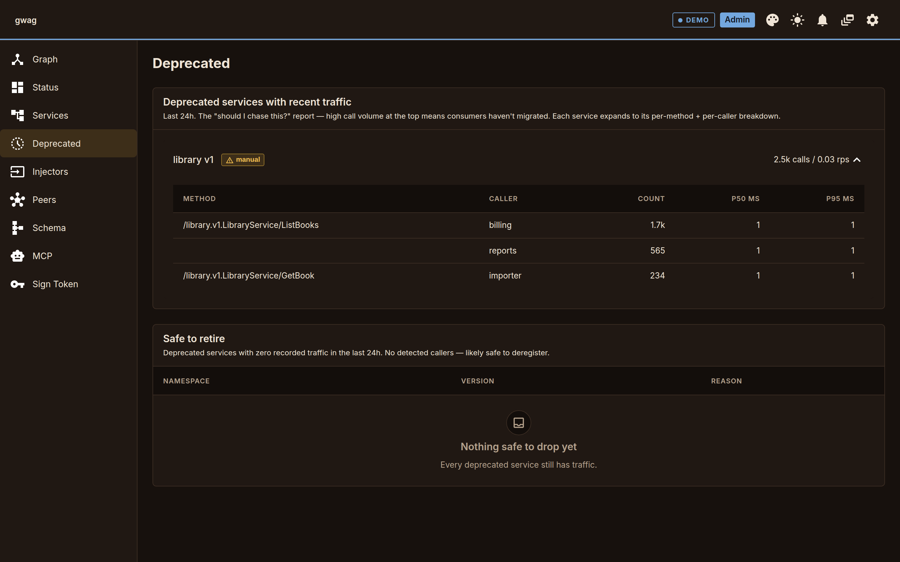

# Service lifecycle

Services don't just appear and vanish — they're version-tagged,
deprecated with warnings, and retired only after their callers move
off. The gateway's job is to make every step of that visible.

## Register

Services self-register over the gRPC control plane and heartbeat
to stay alive. One Register call can carry many services on one
address (multiple RPCs in one binary). Heartbeats every TTL/3;
missed heartbeats past TTL evict.

```go
import (
    _ "embed"

    "github.com/iodesystems/gwag/v2/controlclient"
)

//go:embed greeter.proto
var greeterProto []byte

reg, _ := controlclient.SelfRegister(ctx, controlclient.Options{
    GatewayAddr: "gateway:50090",
    ServiceAddr: "greeter:50051",
    Services: []controlclient.Service{
        {Namespace: "greeter", ProtoSource: greeterProto},
    },
})
defer reg.Close(ctx) // graceful deregister
```

Services ship raw `.proto` bytes; the gateway compiles them via
`protocompile` so leading / trailing comments survive into the
GraphQL SDL. Multi-file `.proto` layouts (one entrypoint with
`import "..."` statements) use `ProtoFS fs.FS` + `ProtoEntry string`
with any `fs.FS` (`embed.FS`, `os.DirFS(...)`, archives), or pass
the imports map explicitly via `ProtoImports map[string][]byte`.

OpenAPI services use the same `Service` struct with `OpenAPISpec`
instead of `ProtoSource`; same shape, both formats ship raw source.
The control-plane API is in
[`gw/proto/controlplane/v1/control.proto`](../gw/proto/controlplane/v1/control.proto).

The usual path for a new service is a profile file (`gwag service
init`), a CI check (`gwag service check`), and a deploy gated on the
gateway's verification of the new instance (`gwag service wait
--green`). A service with no registration client can serve its
profile at `/.well-known/gwag.json` and be added by URL
(`gwag services add --profile-url`). See
[`integrate.md`](./integrate.md).

## Version

A service can register at one of three **tiers** per namespace:

| Tier | What it is | Mutability | Deprecation |
|---|---|---|---|
| `unstable` | Trunk-tip; published on every push from CI | Always overwrites the prior `unstable` | Pinning to it lights up `@deprecated(reason: "unstable — pin to stable or vN for releases")` so codegen flags it in IDE/lint |
| `stable` | Alias to the most-recent numbered cut | Auto-rolls when a new `vN` is registered | Never deprecated |
| `vN` (`v1`, `v2`, …) | Pinned historical cuts | Immutable | Auto-`@deprecated` when a newer `vN` exists |

```graphql
type UserQuery {
  unstable: UserUnstableQuery @deprecated(reason: "unstable — pin to stable or vN for releases")
  stable:   UserV2Query        # alias to the latest cut (currently v2)
  v1:       UserV1Query @deprecated(reason: "v2 is current")
  v2:       UserV2Query
  # newest fields hoisted to the top
  profile(id: ID!): Profile     # from stable / v2
}
```

Flow:

1. **Trunk publishes to `unstable`.** Every CI green re-registers
   the service at `unstable`. The slot is mutable — no `vN` churn,
   no deprecated noise. Teams building against a dep can opt into
   its `unstable` for fast iteration.
2. **Cut a release.** Freeze `unstable` into a new `vN` and roll
   `stable` forward. Older `vN-1` and earlier flip to
   `@deprecated` automatically.
3. **Caller-side lint forces dependency negotiation.** Set
   `controlclient.Options.BuildTag` and the client refuses to
   register `unstable` from a release-tagged binary. A service that
   cuts a release must pin `stable` or a numbered `vN` on its deps
   — if a dep's `unstable` has diverged with breaking changes, you
   can't cut until that dep cuts (or you adopt the break).

Generated clients propagate `@deprecated` through normal codegen
channels: `protoc-gen-go` emits `// Deprecated: ...`,
graphql-codegen emits JSDoc `@deprecated` on TS hooks,
openapi-generator marks operations deprecated.

## Per-tier policy

Each gateway boots with `--allow-tier` controlling which tiers can
register against it:

```bash
# trunk-friendly gateway: anything goes
$ gwag --allow-tier unstable,stable,vN

# release-track gateway: no unstable
$ gwag --allow-tier stable,vN

# locked-down gateway: pinned cuts only (or stable+vN if you want evergreen)
$ gwag --allow-tier vN
```

A service that tries to register a disallowed tier is rejected at
the control plane with a clear error code. Operators who need
physical isolation between deployments (PCI/HIPAA, blast-radius
separation) run multiple gateways with distinct cluster names — that
side of the picture is a deployment concern, not something the
gateway needs to model.

## Deprecate

Two paths:

1. **Auto-deprecation on version fold.** Older `vN` get `@deprecated` automatically when newer cuts register; `unstable` carries a fixed deprecation reason any time it's queried. Free.
2. **Manual deprecate / undeprecate.** Operators flip a `deprecated` bit on any `(namespace, version)` from the admin UI or RPC, with a reason string. Useful for sunsetting a still-current `vN` ahead of cutting `vN+1`, or for un-deprecating in a rollback.

CI gate with `schema diff --strict`:

```bash
$ gwag schema diff \
    --from https://gw.internal/schema \
    --to   ./candidate.graphql --strict
```

`--strict` fails on changes that can break a working client query.
The rules:

- **Breaking** — exit non-zero: required arg / required input field
  removed, output field removed (any nullability), output field type
  changed, default value changed or removed, required arg / required
  input field added without a default, type / enum value removed.
- **Info** — printed but not a failure: optional arg / optional input
  field removed (callers who didn't pass it are unaffected; callers
  who did get a recoverable validation error), default value added,
  optional arg / field added, deprecation flipped on, new types /
  enums / fields.

The conservative "any removal is breaking" policy will relax once
caller-side usage tracking can answer "is anyone passing this
optional arg?" directly. Until then, the relaxation matches the
asymmetric reality that *adding* fields is always safe but
*removing* fields is mostly safe for the optional ones.

### Frozen spec snapshots

When specs are generated from code (huma, gat), freeze each version's
spec as a committed file and let CI compare the generated spec with it:

```bash
$ gwag schema snapshot check  --spec http://localhost:8080/openapi.json \
    --snapshot api/v1.openapi.json
$ gwag schema snapshot update --spec ./gen/v1.graphql --snapshot api/v1.graphql
```

`--format openapi|graphql|proto` is inferred from the file extension
when omitted (`.graphql`/`.gql`, `.yaml`/`.yml`, `.proto`/`.pb`); a
`.json` file needs `--format`. Both sides are normalized before
comparing: sorted definitions, fields and arguments (GraphQL SDL);
sorted keys, YAML accepted (OpenAPI); the compiled `FileDescriptorProto`
without source info as sorted-key JSON (proto; `--spec` may be a
`.proto` source, with `-I DIR,...` for imports, a binary
`FileDescriptorSet`, or protojson). The proto snapshot holds the one
file named by `--spec`.

`check` prints a line diff and classifies the change. Exit codes:

- `0` equal
- `3` differs, additive only (info changes): run `update`
- `4` differs, at least one breaking change
- `1` error, `2` usage

`update` rewrites the snapshot (creates it if missing) and refuses a
breaking change with exit `4` unless `--allow-breaking`, so a frozen
version only grows. Classification:

- GraphQL uses the `schema diff` rules above, same code.
- OpenAPI and proto have no SDL conversion in the CLI. They get a
  structural comparison of the canonical JSON: removed or changed value
  is breaking; added key or array element is info. Arrays of objects are
  matched by `name` (OpenAPI parameters by `in` + `name`); an added
  element with `required: true` is breaking. OpenAPI `description`,
  `summary`, `title`, `example(s)` and `externalDocs` changes are info.
  Other arrays (`required`, `enum`) must be equal. This is stricter than
  an OpenAPI-aware diff in places (an `enum` value added to a response
  is reported breaking) and looser in others (it does not know
  request from response position). Treat exit `3` as a prompt to read
  the diff, not as proof of compatibility. Golden request/response
  tests ([`docs/contract-tests.md`](./contract-tests.md)) cover behavior.

## Retire

Stop heartbeating; the gateway evicts after TTL. The schema
rebuilds; the field disappears.

Serving an old version next to a new one until its callers move, and
the order of deprecate, measure, declare, move and retire, worked
through on a real service: [`versioning.md`](./versioning.md).

### Channel subscriptions

A registration that lists `subscribes` (channel key + consumer group;
see [`pubsub.md`](./pubsub.md#named-channels)) gets one dependency
edge per entry, to the `(namespace, version)` whose proto declares the
channel. The edge counts like a `depends` entry:

- **Start gate.** The binding waits until the declaring line has a
  ready instance. A channel no registered line declares is unmet, so
  the binding waits for it. A channel the binding declares itself is
  ignored.
- **Cycle check.** Resolved channel edges join the depends graph; a
  cycle is refused at Register. An edge to a channel nobody declares
  yet has no target, so a cycle through a waiting declarer is not
  seen (two services that each wait for the other's channel both stay
  waiting).
- **Sunset.** A line with a subscriber is not sunset-able: the
  subscriber accepts only the declaring line.
- **Graph and metrics.** `/admin/graph` lists the edge with
  `edgeKind: "channel"`, `channel` and `group` (RPC edges have
  `edgeKind: "rpc"`); `provider` is empty while nobody declares the
  channel. `dependency_unmet` has a `channel` label.
- **Admin output.** `/admin/services` rows carry `subscribes`;
  instance `depends` entries carry `channel` and `group`.

Subscriptions do not block a drain: events wait in the channel's
stream while the publisher is down.

### External dependents

A line is sunset-able (admin graph `sunsetable`, metric
`line_sunsetable`) when every dependent that accepts it also accepts
another line with a ready instance, and it had no traffic in the
window. Dependents are the `depends` of registered services. A
consumer the gateway cannot see (an API customer, a partner
integration, a mobile app release) is declared as an external
dependent:

```bash
curl -X PUT https://gw.internal/api/admin/external-dependents/acme \
  -H "Authorization: Bearer $TOKEN" -H 'Content-Type: application/json' \
  -d '{"name":"Acme Corp","kind":"customer",
       "owner":{"team":"books","contact":"acme-api@example.com"},
       "depends":[{"service":"library","lines":["v1"]}],
       "note":"contract 2026-14","reviewAt":"2027-06-30T00:00:00Z"}'
```

It counts wherever a registered dependent counts: library v1 is not
sunset-able while Acme pins only v1, a drain of the last ready v1
instance is `blocked` with a reason naming Acme, and
`dependency_unmet{consumer_kind="external",consumer_namespace="acme"}`
is 1 while no pinned line has a ready instance. It does not affect the
start gate. `kind` is `customer`, `partner`, `app` or `other`; lines
follow the `depends` rule (`vN` or `unstable`). A pin on a service or
line that is not registered is accepted, with a warning in the
response. In a cluster the declarations live in the
`gwag-external-dependents` KV bucket and apply on every node. The
admin UI draws them on the dependency graph and edits them there.

#### Review date

`reviewAt` (RFC 3339) is required. A declaration pins lines for months
or years, so the gateway does not act on the date by itself: past
`reviewAt` the declaration keeps counting everywhere (sunset rule,
drain coverage, `dependency_unmet`, graph edges). It is listed with
`reviewDue: true`, is an item in `GET /admin/notifications` (the admin
UI's bell), and adds to the `declarations_review_due` gauge, until a
person reviews it. The response warns when `reviewAt` is in the past
or more than a year out; it still stores the declaration.

To review, confirm the pins with the owner and set the next date:

```bash
curl -X POST https://gw.internal/api/admin/external-dependents/acme/review \
  -H "Authorization: Bearer $TOKEN" -H 'Content-Type: application/json' \
  -d '{"reviewAt":"2028-06-30T00:00:00Z"}'
```

The review op changes only `reviewAt`, `reviewedAt` (now) and
`reviewedBy`; a new `reviewAt` must be in the future. A PUT can also
set a new date; it keeps `reviewedAt` / `reviewedBy`. A declaration
stored without a review date is review-due. Delete it with
`DELETE /admin/external-dependents/acme`.

**Who is recorded.** `reviewedBy` and `updatedBy` come from the
credential, never from the request body. The value is the role the
bearer resolved to, `admin` or `dev`, plus `:subject` when the
`AdminAuthorizer` delegate names one in `AuthorizeResponse.subject`
(for example `dev:alice@example.com`; a subject is trimmed, stripped of
control characters and cut at 128 characters). A bearer matched against
the boot or dev token has no subject, so it records the role alone.
`updatedBy` is set by put and review; the delta sink payload carries
the same identity as `by`.

#### Notifications

`GET /admin/notifications` (GraphQL `admin.listNotifications`) lists
the items that need a person, oldest first:

```json
{"items": [{"kind": "declaration_review_due", "id": "review-due/acme",
  "title": "Review external dependent Acme Corp",
  "detail": "Review date 2027-06-30T00:00:00Z has passed. It still pins library [v1]. ...",
  "since": "2027-06-30T00:00:00Z", "href": "/?select=ext:acme",
  "dismissable": false}]}
```

| `kind` | Item | Goes away |
|---|---|---|
| `declaration_review_due` | A declaration past `reviewAt`. Same on every node. | When it is reviewed or deleted. |
| `declaration_hook_failed` | A declarations hook delivery that ran out of retries. Same on every node in a cluster (the `gwag-notifications` KV bucket); in memory standalone. At most 20; the oldest is deleted beyond that. `dismissable: true`. | Full mode: when a later delivery succeeds, from any node, that covers it (the receiver has the whole set again). Delta mode: only when a person dismisses it. |

A delta-mode failure means the receiver missed a change. Resync it from
`GET /admin/external-dependents`, then clear the item with
`POST /admin/notifications/{id}/dismiss` (GraphQL
`admin.dismissNotification`; dev or admin role; the bell has a Dismiss
button). The item is deleted on every node, and nothing is dismissed
by the clock: the bucket has no TTL. A computed item
(`declaration_review_due`) cannot be dismissed (404). A full-mode item
can be dismissed too.

More kinds may be added; a client shows an unknown kind by its
`title`, `detail` and `href`. `href` is an admin UI route.

#### Declaration sinks

Two optional sinks tell systems outside the gateway about every put,
review and delete. Each has a mode: `full` (the whole current set) or
`delta` (one change).

| Flag (`gwag up`, example gateway) | Library |
|---|---|
| `--declarations-hook URL` | `WithDeclarationsHook(DeclarationsHookOptions{URL, ...})` |
| `--declarations-hook-secret S` | `DeclarationsHookOptions.Secret` |
| `--declarations-hook-mode full\|delta` (default full) | `DeclarationsHookOptions.Mode` |
| `--declarations-file PATH` | `WithDeclarationsFile(DeclarationsFileOptions{Path, ...})` |
| `--declarations-file-mode full\|delta` (default full) | `DeclarationsFileOptions.Mode` |

**Hook secret.** The secret is a raw string (its bytes are the HMAC
key), and a weak one is refused at start: `gwag up` exits with an
error, and `New` panics for `DeclarationsHookOptions.Secret`. It needs
at least 32 bytes and an estimated 128 bits of entropy. The estimate
collapses a repeated unit (`abcabc...` counts as `abc`), ignores bytes
that continue a constant-step run (`aaaa`, `abcdef`, `97531`), then
multiplies the Shannon entropy of the remaining bytes by their count.
It is a floor against lazy secrets, not a proof of randomness: it
cannot see a dictionary phrase. `openssl rand -base64 48` and
`gwag secret gen` print a 64-character secret that scores about 250
bits; a random 32-character hex string scores about 118 and is
refused. The hex secrets (`--subscribe-secret`, `--signer-secret`)
are not refused; the gateway logs a warning at start when one decodes
to under 16 bytes.

**Hook.** A POST of one JSON payload per change, `Content-Type:
application/json`. The admin response does not wait for it: a worker
queue sends it after the declaration is stored. In a cluster only the
node that accepted the write sends it, so each change is POSTed once.
Headers:

| Header | Value |
|---|---|
| `X-Gwag-Event` | `put`, `review` or `delete` |
| `X-Gwag-Delivery` | Random id, the same on every retry of one change. Deduplicate on it. |
| `X-Gwag-Timestamp` | Unix seconds when this try was sent. |
| `X-Gwag-Signature` | With a secret: `sha256=` + hex(HMAC-SHA256(secret, timestamp + `.` + body)). The key is the secret's bytes as given. |

To verify: recompute the HMAC over the timestamp header, a `.` and the
raw body, compare in constant time, and reject a timestamp more than a
few minutes old (that blocks replay).

A 2xx answer is success. A network error, a 5xx, 408 or 429 is retried
with exponential backoff (500ms, doubling, at most 8s between tries,
6 tries in all; `DeclarationsHookOptions` changes these). Any other
4xx is not retried. When a change is given up, the node logs it,
increments `declarations_hook_failures_total` and lists a
`declaration_hook_failed` notification (see Notifications above for
how it clears). The queue (256 changes) is in
memory: a delivery still pending when the accepting node stops is
lost, and a change that finds the queue full fails at once. In full
mode the next successful delivery carries the whole set; in delta mode
resync from `GET /admin/external-dependents`.

**File.** Every node writes its own file at PATH from the replicated
set, on every change it sees through the KV watch (standalone: on
every write). The directory must exist.

- `full`: the file is the full payload below, indented JSON. Each
  change replaces it: a temp file in the same directory, fsynced,
  mode 0644, renamed over PATH, so a reader sees the old file or the
  new one, never part of one. Written at start (standalone) or once
  the node has replayed the bucket (cluster). JSON, not YAML: it is
  the same document the hook sends, and needs no second schema.
- `delta`: one delta payload per line (JSON Lines), appended. A node
  writes no lines for the state it loads at start, only for changes
  after it; use full mode, or the `seq` gaps, to detect what a node
  missed while it was down. The gateway never rotates the file. It
  opens the file for each line, so an outside rotation that renames
  it (logrotate's default) works: the next change creates a new file.

**Payloads (stable).** `seq` orders changes: in a cluster it is the KV
revision of the change, the same on every node; standalone it counts
from 1 and restarts with the process, as the set does. A receiver keeps
the payload with the highest `seq`. Times are RFC 3339 UTC.

Full, `schema: "gwag.declarations.full/v1"`:

```json
{
  "schema": "gwag.declarations.full/v1",
  "seq": 42,
  "at": "2026-11-07T12:00:00.000Z",
  "declarations": [
    {
      "id": "acme",
      "name": "Acme Corp",
      "kind": "customer",
      "owner": {"team": "books", "contact": "acme-api@example.com"},
      "depends": [{"service": "library", "lines": ["v1"]}],
      "note": "contract 2026-14",
      "reviewAt": "2027-06-30T00:00:00Z",
      "reviewedAt": "",
      "reviewedBy": "",
      "updatedAt": "2026-11-07T12:00:00.000Z",
      "updatedBy": "dev:alice@example.com"
    }
  ]
}
```

`seq` is the revision the set is as of; `at` is when the payload was
built; `declarations` is sorted by `id` and never null. In a declaration
`owner` is `null` when none was given, and an empty string means unset
for the other string fields.

Delta, `schema: "gwag.declarations.delta/v1"`:

```json
{
  "schema": "gwag.declarations.delta/v1",
  "seq": 43,
  "op": "review",
  "id": "acme",
  "before": {"id": "acme", "reviewAt": "2027-06-30T00:00:00Z", "...": "..."},
  "after":  {"id": "acme", "reviewAt": "2028-06-30T00:00:00Z", "...": "..."},
  "at": "2027-07-01T09:30:00.000Z",
  "by": "dev:alice@example.com"
}
```

`by` is the authenticated identity that made the change (see "Who is
recorded"). On a delete, the KV delete leaves no value, so only the
node that accepted it knows `by`: the hook payload has it, a delta
file line written by another node has `""`.

`op` is `put`, `review` or `delete`. `before` is `null` when the put
created the declaration; `after` is `null` on delete. Both have the
declaration shape above. A new field may be added to either schema; a
field is not removed or changed in meaning without a new `schema`
value.

## Promotion path

The tier flow above is the per-namespace story. Two extra gates wire
the same axis into CI:

1. **`services list`** exposes per-pool hashes — CI diffs hash sets
   across clusters to confirm the bytes match for every
   `(namespace, tier|version)` you intend to promote.
2. **`/schema` + `schema diff --strict`** is the client-perspective
   gate — additions are fine, removals or required-arg changes fail
   the build (rules in [Deprecate](#deprecate)).

Per-cluster drift is prevented by the canonical hash gate in the
pool: a replica with a mismatched proto can't join an existing
`(ns, version)` pool.

## Who still calls a deprecated version

The `dispatch_duration_seconds` Prometheus histogram already carries
a `caller` label (extracted via the caller-identity seams documented
in [`caller-identity.md`](./caller-identity.md) — forgeable-by-design
"public" mode, HMAC for production, delegated when you want richer
attrs alongside), so "who's calling this method?" is queryable today.

The admin UI answers it on the **Deprecated** page: each deprecated
`(namespace, version)` with traffic in the last 24 hours expands to its
per-method, per-caller counts and p50 / p95 latency, and a second table
lists deprecated versions with no traffic ("Safe to retire"). Caller
names come from the caller-identity seam, so without `--caller-id-public`
(or a real identity mode) every caller reads `unknown`.


