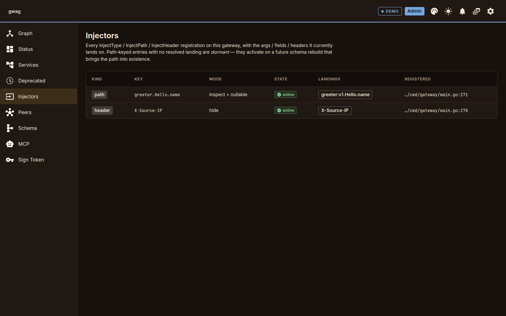

# Middleware

One `Transform` declaration carries up to four reshaping concerns
that fire at different layers, in lockstep:

| Field | Layer | Effect | Construction |
|---|---|---|---|
| `Schema` (`[]SchemaRewrite`) | once at boot | Rewrites the external schema (hide types, hide fields, flip nullability) | `HideType[T]()` and friends, or pass `Transform{Schema: ...}` directly |
| `Runtime` (`Middleware`) | per request | Wraps the dispatch handler — read or mutate request and response | Function value passed to `Transform{Runtime: ...}` |
| outbound headers | per dispatch | Stamps outbound HTTP headers / gRPC metadata | **Constructed via `InjectHeader`; the field is opaque.** |
| injector inventory | registration time | Surfaces what an operator declared at `/admin/injectors` | **Populated by `InjectType` / `InjectPath` / `InjectHeader`; the field is opaque.** |

`Runtime` is the same `next()` chain you've seen in every Go
middleware library:

```go
mw := func(next gateway.Handler) gateway.Handler {
    return func(ctx context.Context, req protoreflect.ProtoMessage) (protoreflect.ProtoMessage, error) {
        // pre — filter or transform request
        resp, err := next(ctx, req)
        if err != nil { return nil, err }
        // post — transform response
        return resp, nil
    }
}

gw.Use(gateway.Transform{Runtime: mw})
```

- **Observer**: call `next`, return its result, do something on the side (log, metric, trace).
- **Filter**: return an error without calling `next` (auth, rate limit, allow-list). Use `gateway.Reject(code, msg)` so the gateway can map to the right GraphQL error.
- **Transform**: wrap `next` and mutate input or output.

Schema and Runtime often need to stay in sync — hiding `userID` from
the external schema is meaningless without a runtime hook to fill it
from context. The library ships three constructors that build a
matched `Transform` so the schema/runtime invariant is enforced by
construction:

| Constructor | What you address | Schema half | Runtime half |
|---|---|---|---|
| `InjectType[T](resolve, opts...)` | every field/arg of Go type `T` | hides (default) or `Nullable(true)` | calls `resolve(ctx, current *T)` to fill the field |
| `InjectPath("ns.method.arg", resolve, opts...)` | one specific call site (only way to address a primitive arg) | hides or rewrites at that path | resolves at request time for that path |
| `InjectHeader(name, resolve, opts...)` | one outbound HTTP header / gRPC metadata key | n/a | adds the header on every dispatch |

`Hide(true)` (the default for `InjectType` / `InjectPath`) strips the
arg from the external schema and the resolver always sees
`current=nil`. `Hide(false)` keeps the arg visible and gives the
resolver the caller-provided value to inspect-and-decide.

Single-purpose middleware (logging, rate limit) builds a `Transform`
that fills only `Runtime`.

> **Subscriptions don't run through `Runtime`.** Server-streaming
> RPCs are exposed as GraphQL subscription fields backed by NATS
> pub/sub (see [`pubsub.md`](./pubsub.md) once it lands; today's
> README has the current mental model); the per-request middleware
> chain is for unary calls.

## Injectors page

**Injectors** in the admin UI lists every `InjectType`, `InjectPath` and
`InjectHeader` registration on the gateway you are connected to. It
refreshes every 10 s. The shot is the `examples/multi` gateway with a
greeter registered.



| Column | Meaning |
|---|---|
| Kind | `type`, `path` or `header`: the constructor used. |
| Key | What it addresses: the Go type name, the `ns.method.arg` path, or the header name. |
| Mode | `hide` (the schema drops the arg and the resolver sees `current=nil`) or `inspect` (`Hide(false)`: the arg stays and the resolver sees the caller's value). `nullable` is added when `Nullable(true)` made the arg optional. |
| State | `active`: the key resolved against the current schema. `dormant`: a path with no match yet, for example a service that has not registered. It activates on the schema rebuild that brings the path in. |
| Landings | Where it applies now: `ns:version.op.arg` for an arg, `ns:version · Type.field` for a field, the header name for a header. Empty (`—`) while dormant. |
| Registered | `file:line` of the `gw.Use` call, last three path segments. Hover for the function name. |

Here `greeter.Hello.name` is `inspect + nullable` and landed on
`greeter:v1.Hello.name` once the greeter registered. `X-Source-IP` is a
header injector, so it has no schema landing beyond the header name.
With no registrations the page reads "No injectors". The page is
read-only and needs the dev role or above
([`admin-auth.md`](./admin-auth.md)). A gateway built from `gwag up`
registers none: injectors are Go code, added with `gw.Use` in your own
gateway binary.

## The auth case end-to-end

The shape that drove the API: globally hide auth fields, fill them from
a registered auth service, and hide that service from the external
schema too. See [`examples/auth`](../examples/auth):

```go
gw := gateway.New()

// Internal: not exposed in the GraphQL surface, but callable by hooks.
gw.AddProto("./protos/auth.proto",
    gateway.To(authConn),
    gateway.AsInternal(),
)

// Public services.
gw.AddProto("./protos/user.proto", gateway.To(userConn))

// One declaration: schema half hides every input field of type
// *authv1.Context; runtime half fills them. With Hide(true) the arg
// never reaches the wire, so `current` is always nil here.
gw.Use(gateway.InjectType[*authv1.Context](func(ctx context.Context, _ **authv1.Context) (*authv1.Context, error) {
    token := bearerFromContext(ctx)
    if token == "" {
        return nil, gateway.Reject(gateway.CodeUnauthenticated, "missing bearer token")
    }
    resp, err := authClient.Resolve(ctx, &authv1.ResolveRequest{Token: token})
    if err != nil {
        return nil, err
    }
    return resp.GetContext(), nil
}))

http.ListenAndServe(":8080", gw.Handler())
```

External GraphQL surface contains no `auth` namespace and no
`Context` type. Internally, every RPC whose input embeds
`auth.v1.Context` gets it filled from one cached call to the auth
service per request.
