# gwag admin UI

React + MUI + TanStack Router admin console for an instance of
gwag. Talks to the gateway over **GraphQL only** — every
view (services, peers, schema, future pages) is a graphql-codegen-typed
query against `/graphql`.

This is a **dogfood** of the project's stance: the gateway exposes its
own admin operations as GraphQL (via self-registration of the control
plane proto + planned huma route ingestion), and the UI consumes them
the same way any external client would.

## Build flow

```
1. start the gateway        cd ../examples/multi && ./run.sh
2. fetch + codegen          pnpm run gen
3. dev server               pnpm run dev   → http://localhost:5173
4. production build         pnpm run build → dist/
```

`pnpm run gen` is `pnpm run schema && pnpm run codegen`:

- `schema` — `curl ${GATEWAY_URL:-http://localhost:18080}/schema/graphql > schema.graphql`
- `codegen` — graphql-codegen reads `schema.graphql` + `src/**/*.graphql` and
  emits typed functions into `src/api/gateway.ts`.

After codegen, every page imports `sdk.<OperationName>` from
`@/api/client` and gets typed args + responses for free. Add a new
operation: drop a `query Foo { ... }` into `src/queries.graphql` (or
inline in a `.tsx` via a tagged template — codegen reads both),
re-run `pnpm run gen`, use `sdk.Foo()` in any component.

## Layout

```
package.json                pnpm dependency manifest
codegen.ts                  graphql-codegen config
vite.config.ts              Vite + TanStack-Router-Vite plugin
schema.graphql              SDL cache (overwritten by `pnpm run schema`)
src/
  main.tsx                  Provider wiring (MUI theme, TanStack Query, Router)
  routeTree.gen.ts          Generated by @tanstack/router-plugin
  api/
    client.ts               GraphQLClient + sdk; lazy Authorization header
    auth.ts                 sessionStorage-backed admin token store
    events.ts               graphql-ws client (subscriptions over /api/graphql)
    gateway.ts              Generated by codegen (placeholder otherwise)
  providers/
    EventsProvider.tsx      graphql-ws subscriptions + ring buffer; useSubscribe() / useEvents()
  components/
    Layout.tsx              AppBar (theme, events, settings, SSO) + side nav shell
    SettingsDrawer.tsx      Theme picker + bearer token entry; useAdminToken() hook
    EventsTray.tsx          Slide-out drawer rendering recent events
  routes/
    __root.tsx              Wraps every page in <Layout>
    index.tsx               Graph: dependency graph (/)
    status.tsx              Per-service calls, errors, latency (/status)
    services.tsx            Services table, deprecate / retract (/services)
    deprecated.tsx          Deprecated versions and their callers (/deprecated)
    injectors.tsx           InjectType / InjectPath / InjectHeader list (/injectors)
    peers.tsx               Peers table + Forget mutation (/peers)
    schema.tsx              GraphQL SDL / OpenAPI / Protobuf viewer (/schema)
    mcp-allowlist.tsx       MCP include / exclude patterns (/mcp-allowlist)
    token-signer.tsx        Sign subscribe token (/token-signer)
  queries.graphql           Operations consumed by codegen
```

## Hosting

All gateway endpoints live under `/api/*` so the SPA owns the
root. In dev, Vite proxies `/api` to the gateway (default
`http://localhost:18080`; override with `GATEWAY_URL` env). In
production, `pnpm run build` populates `dist/`, and the
`//go:embed all:dist` directive in `../ui/embed.go` bakes it into
the gateway binary — `gateway.UIHandler(ui.FS())` mounts at `/`
with SPA-style fallback to `index.html`.

Single-binary boot:

```
cd ui && pnpm install && pnpm run build
cd ..
go run ./examples/multi/cmd/gateway --nats-data /tmp/gw1
# UI at http://localhost:8080/, GraphQL at /api/graphql
```

## Pages

Screenshots are generated, not hand-made: `bin/shots` (repo root) boots
a private gateway with the `examples/multi` services, sends traffic and
writes `docs/img/admin-*.png`. Run it after a UI change.

**Graph** (`/`). Declared dependencies (solid) and observed calls
(dashed) between external callers and services. Toggles: Desired /
Active / Both, "Gateway services", a time window, "External dependent"
to declare one.

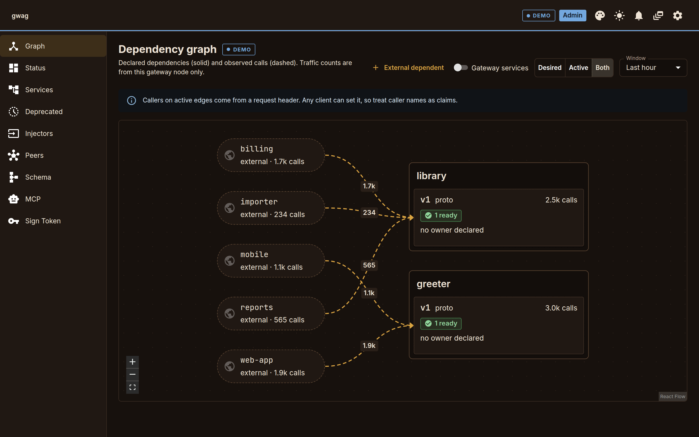

**Status** (`/status`). One row per service: health, calls, errors,
p50 / p95 / p99, and a per-minute sparkline for the last hour. Needs no
token for public services.

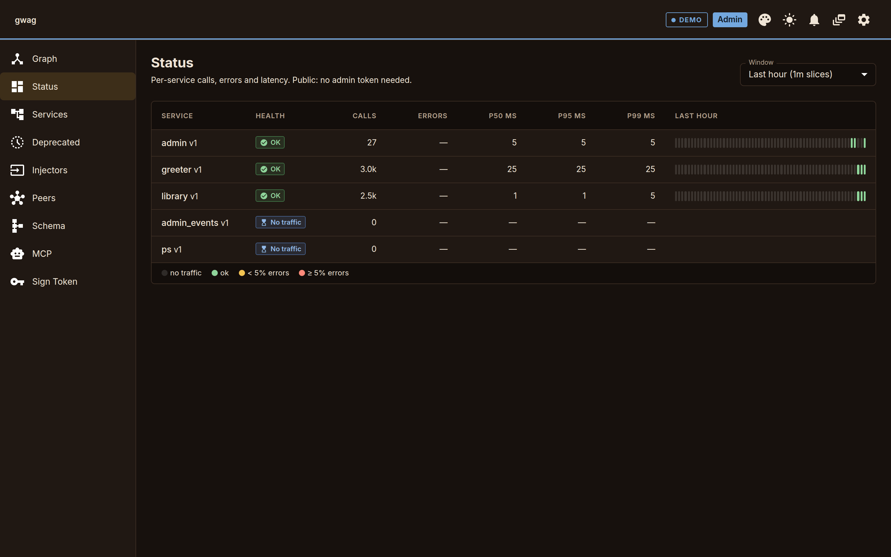

**Services** (`/services`). Namespace, version, tier, STATUS (Ready,
deprecated), replicas, calls / 24h, p50 / p95, calls / s. Row actions:
Deprecate (asks for a reason) / Undeprecate, Retract Stable.

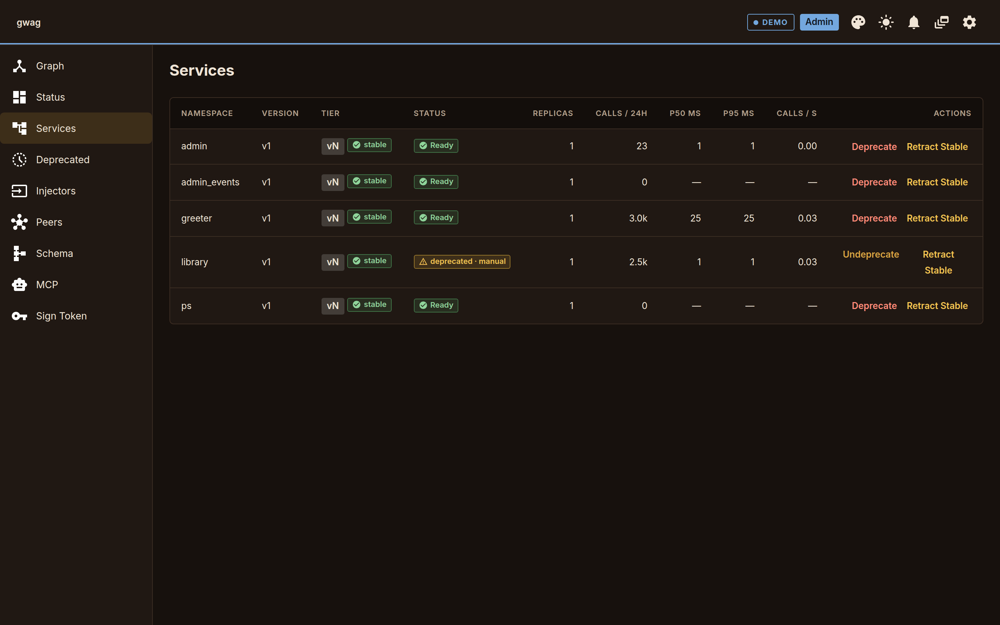

**Deprecated** (`/deprecated`). Deprecated versions with traffic,
expanded per method and caller, then "Safe to retire".

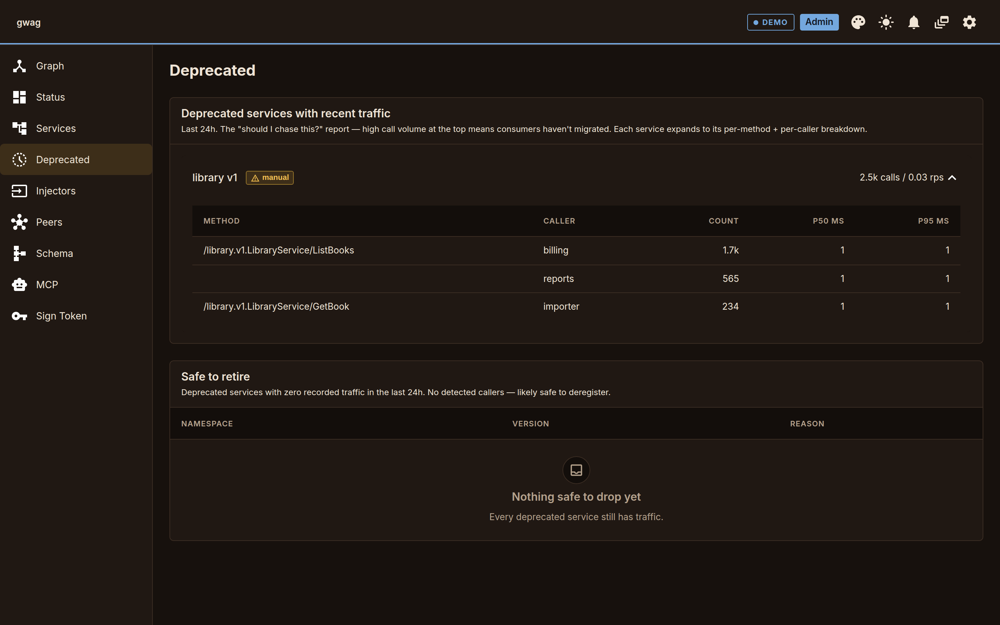

**Peers** (`/peers`). Gateways in the cluster with a Forget action. A
single node with no cluster shows "Standalone, not clustered" when the
list is empty.

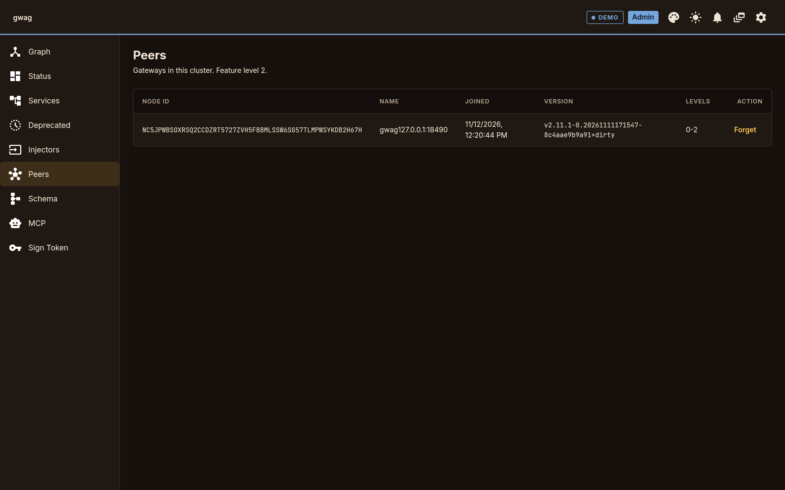

**Schema** (`/schema`). The gateway schema as GraphQL SDL (syntax
highlighted), OpenAPI or Protobuf SDL, with Filter by service and
Download.

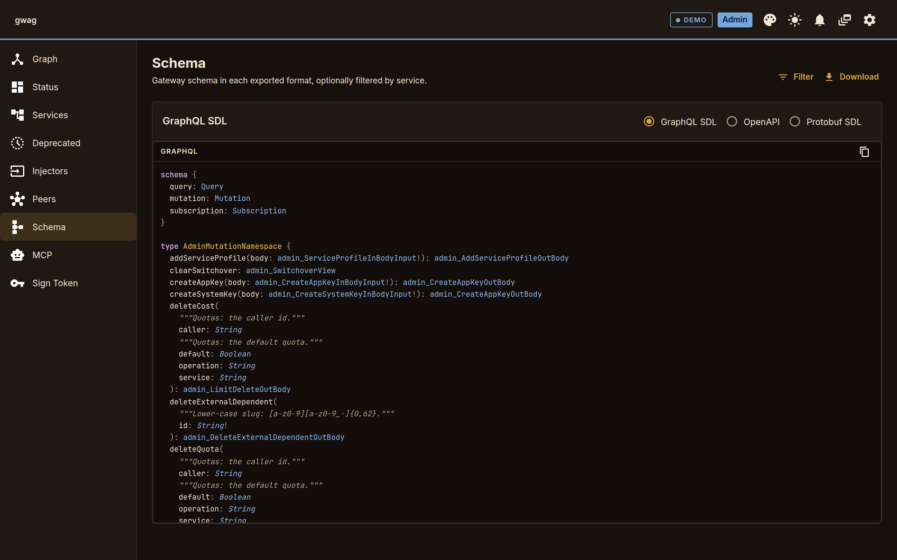

**MCP** (`/mcp-allowlist`). Include and exclude patterns for what `/mcp`
exposes, an Auto-include switch, and a live "Allowed operations" preview.
Details: [`docs/mcp.md`](../docs/mcp.md).

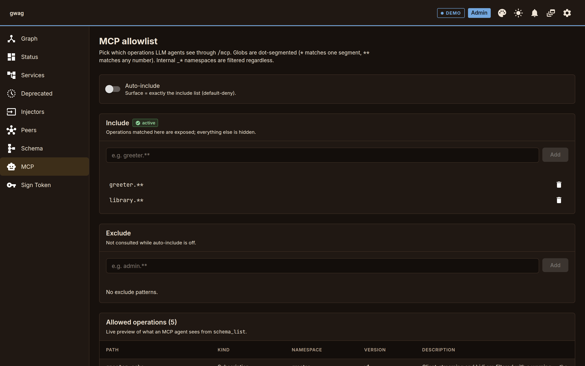

**Sign Token** (`/token-signer`). Channel, TTL and kid in; hmac and
timestamp out. Admin only. The CLI equivalent is `gwag ctl sign`.

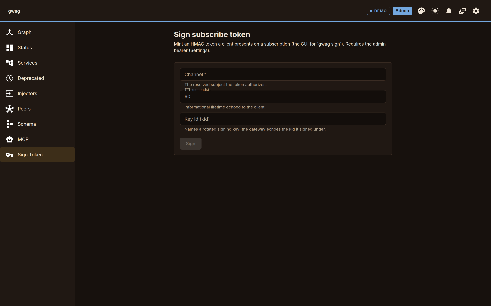

**Injectors** (`/injectors`). Lists `InjectType`, `InjectPath` and
`InjectHeader` registrations; empty on the example stack.

## Themes

Six presets, each with a dark and a light mode: glow, walnut (default),
graphite, paper, harbor, terminal. Pick one from the palette icon in the
app bar or the Settings drawer; the sun / moon icon switches mode. Both
choices are kept in `localStorage` (`gwag.ui.themePreset`,
`gwag.ui.themeMode`).

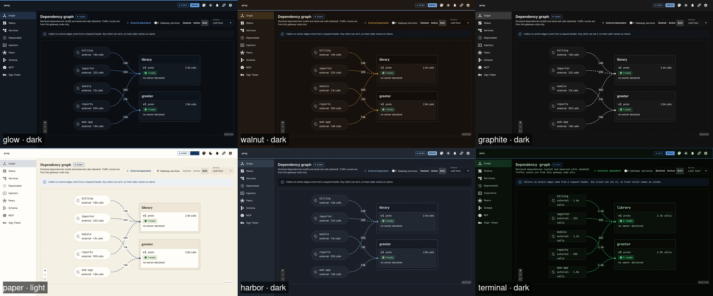

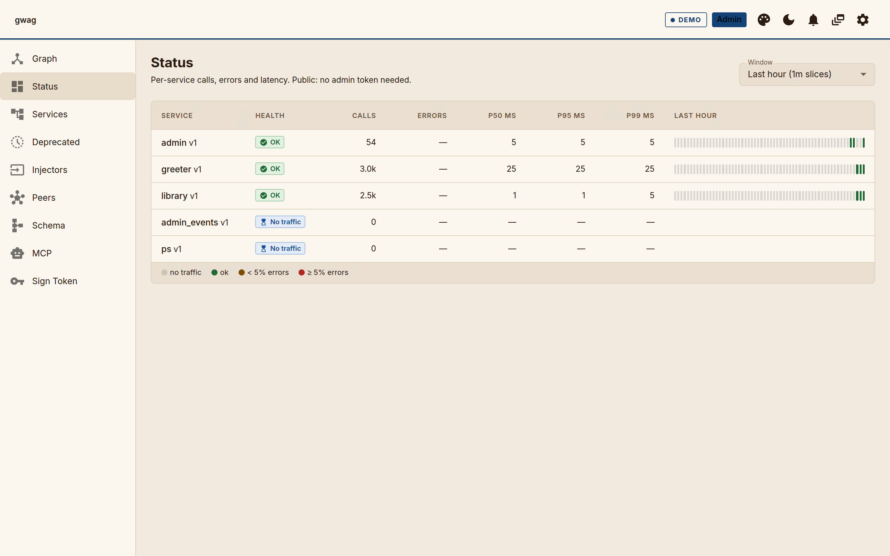

## Auth

The gateway logs `admin token = …` and `dev token = …` at boot. The UI
works in three states:

- **No token.** Public view: the Graph and Status pages show services
  marked public. The app bar has "Sign in" (and "Sign in with SSO" when
  the gateway has `--sso-*` set; the token button then reads "Use a
  token").

  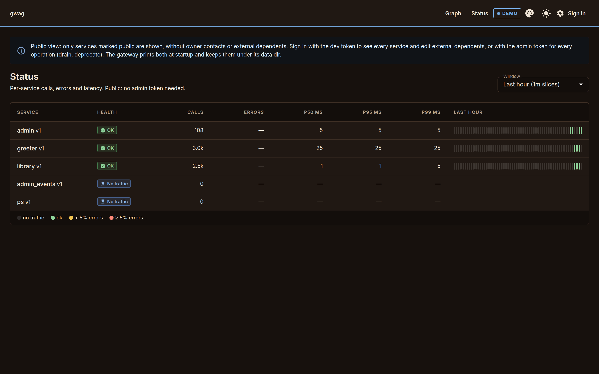

- **Dev token.** Every service, external dependents editable.
- **Admin token.** Also every write: drain, deprecate, forget peer,
  sign tokens.

To sign in with a token:

1. Click the gear icon in the app bar (Settings drawer).
2. Paste the token under "Bearer token".
3. Click Save. The app bar chip shows the role (Admin / Dev).

graphql-request reads it from `sessionStorage` per request and sends
`Authorization: Bearer <token>`. Storage is sessionStorage only: closing
the tab discards it, refresh keeps it. There is no "remember me"; the
gateway boot log is the source of truth, and persistent UI storage of a
long-lived bearer is the kind of thing that ends up in a screenshot.

If the deployment fronts the gateway with another auth layer (session
cookie, OAuth proxy), that is same-origin transparent to the UI; the
bearer is a separate concern for the gateway's own admin surface. SSO
setup: [`docs/admin-auth.md`](../docs/admin-auth.md#sso).

## Events provider

The Layout is wrapped in `<EventsProvider>` so any descendant page
can opt into a graphql-ws subscription:

```tsx
import { useSubscribe } from '@/providers/EventsProvider';

useSubscribe<{ greeter_greetings: { greeting: string; forName: string } }>({
  id: 'greeter-alice',
  query: `subscription ($name:String!,$hmac:String!,$timestamp:Int!) {
    greeter_greetings(name:$name, hmac:$hmac, timestamp:$timestamp) {
      greeting forName
    }
  }`,
  variables: { name: 'alice', hmac: 'x', timestamp: 0 },
  onData: (p) => console.log(p),
});
```

Every event also lands in a global ring buffer (last 50). The bell
icon in the AppBar shows the unread count and opens an `EventsTray`
drawer that renders the buffer as a reverse-chronological feed.
graphql-ws is lazy: the WebSocket opens on the first subscribe and
closes after the last unsubscribe.

In production, subscription args (`hmac`, `timestamp`) come from
`admin_signSubscriptionToken`. Dev gateways started with
`--insecure-subscribe` accept any value.

## Useful pnpm scripts

```
pnpm run dev        # vite dev server with HMR
pnpm run build      # vite build && tsc --noEmit → dist/
pnpm run typecheck  # tsc --noEmit (TypeScript 7)
pnpm run lint       # oxlint --type-aware (.oxlintrc.json)
pnpm run preview    # vite preview against dist/
pnpm run schema     # refresh schema.graphql from the running gateway
pnpm run codegen    # graphql-codegen against schema.graphql
pnpm run gen        # schema + codegen
```
